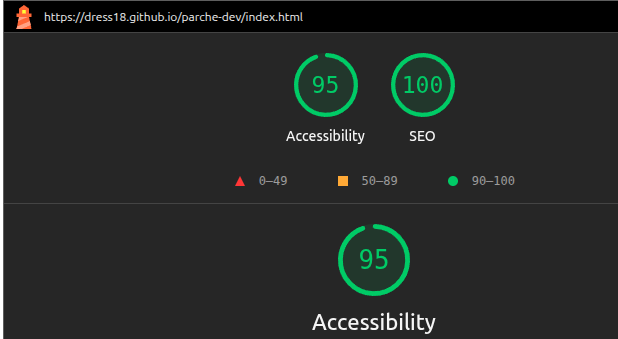

# Parche Dev 2026

Sitio oficial del encuentro Parche Dev 2026, construido solo con HTML semántico.
Reto individual del Módulo 1 · HTML y CSS, RIWI.

Sitio publicado: https://dress18.github.io/parche-dev

## Páginas

- Inicio
- Agenda
- Ponentes
- Inscripción y confirmación
- Código de conducta

## Cómo verlo en tu computador

1. Clona el repositorio.
2. Ábrelo en VS Code.
3. Abre index.html con Live Preview.

## Decisiones que tomé

- 1. En la información del evento en el index, utilice dl en lugar de ol o ul para poder agrupar información dentro de la misma lista
  2. Utilicé un ul dentro de un ul en la información de los ponentes en la página ponentes.html, para una mejor organización de la información que se muestra
  3. Utilicé un li en la seccion de reservar en la página de index en lugar de un botón, para que de una vez me lleve a la página de registro, sin utilizar nada de JS
- 5-1. ¿Qué aparece después del ??: Aparece toda la información que el usuario ingresó
  5.2. ¿Cómo se ven los espacios, las tildes y la arroba?: los espacios con un +, las tildes se ven normales y el arroba con un %
  5.3. ¿Qué pasa con los campos que no llenaste?: No aparecen en la url
  5.4. ¿Por qué un formulario con contraseñas nunca debería usar method="get"?: Porque esto expone la contraseña, el GET solo se utilizaría para datos que se pueden exponer 

## Lo que aprendí

- A verificar el seo de la página, a tener una mejor organización y cómo distribuir mejor la información en una página

## Captura de SEO y Accessibility

## Hecho por

Andrés Felipe Gómez Jiménez · [GitHub](https://github.com/dress18)